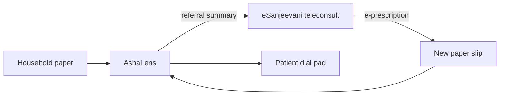

# eSanjeevani vs AshaLens: feature-gap roadmap

eSanjeevani connects a patient or rural health centre to a doctor over video. AshaLens works before and after that call: it reads the household's paper, flags safety checklists, and speaks confirmed medicines back to the family. AshaLens should feed eSanjeevani, not compete with it.

There is **no live integration** with eSanjeevani, ABDM, or ABHA in this repository.

## Source note

The eSanjeevani side of this note comes from a user-supplied reverse-engineering report (November 2026) plus public programme descriptions. Treat these as **confirmed**:

- Owner: Ministry of Health and Family Welfare
- Developer: C-DAC Mohali
- Two service models: AB-AAM (hub-and-spoke) and OPD
- ABHA linkage and e-prescriptions are part of the public programme

Treat these as **unverified / inferred** until a primary source is cited: Angular and hash routing, .NET / C# / SQL Server, Azure or OpenAI usage, SHA-1 / 3DES / AES details, SFU or MCU media servers, and any consultation or facility counts. Do not repeat those numbers in a pitch.

## Side by side

| | eSanjeevani | AshaLens |
| --- | --- | --- |
| Who it is for | Patient, CHO, specialist doctor | ASHA worker, visiting doctor, household |
| Core job | Live teleconsultation and e-prescription | Paper capture, safety flags, spoken medicines |
| Entry | Web or Android, then a video room | Phone camera, or a keypad phone |
| Connectivity | Needs a call path (WebRTC; TURN in poor networks) | Capture and samples work offline; speech needs a cache or network |
| "AI" role | Reported AI-CDSS for the doctor (unverified internals) | Rule checks and extraction. A person confirms. No diagnosis |
| Standards | ABDM, reported FHIR / SNOMED / DICOM | Local FHIR download and a small SNOMED demo map. ABHA is stored, not verified |
| Languages | Reported 22+ via Bhashini (unverified coverage) | Tamil and English templates, plus Sarvam speech |
| Auth | OTP, ABHA (public programme) | Demo login. PIN on the dial pad. RLS designed, not deployed |

## Feature decisions

Decisions for the 20 features in the source report.

### Copy now

| Feature | Decision | What exists |
| --- | --- | --- |
| 17 Follow-up scheduling | Copy the visit-order idea, not a booking calendar | Week ranker and "This week" list |
| 19 Audit trail | Copy a narrow log | `dialpad_access_logs` in [supabase/migrations/001_ashalens.sql](../supabase/migrations/001_ashalens.sql) |
| 12 Role-based access | Copy the roles on paper, then in the database | RLS policies for `asha`, `doctor`, `admin` in the same migration |
| Referral handoff (from hub-and-spoke, feature 5, narrowed) | A printable summary the ASHA worker can hold up before a consult | Demo screen at `/app/patients/[id]/summary`. No live eSanjeevani integration |

### Adapt

| Feature | Decision |
| --- | --- |
| 8 AI-CDSS | Keep the rule list (duplicates, spacing, pregnancy caution, NHM danger signs). Do not call it a diagnosis engine |
| 9 Bhashini | Sarvam Tamil and English today. Bhashini is an optional later speech or translation provider |
| 18 Notifications | Dial-pad key 9 logs an ASHA callback. SMS is later, not a second queue product |

### Integrate later, do not rebuild

| Feature | Decision |
| --- | --- |
| 2 ABHA ID | Column exists (`patients.abha_id`). Linking goes through the ABDM sandbox, not a homemade ID |
| 13 Consent manager | Use ABDM consent. Do not invent a second consent product |
| FHIR (standards row) | Phase B export: Patient, MedicationStatement, Observation, Flag |
| SNOMED CT | Phase C codes on drugs and findings, after a formulary is stable |
| 5 Hub-and-spoke routing | Hand a summary to eSanjeevani AB-AAM. Do not route patients ourselves |

### Skip

These stay on eSanjeevani. AshaLens has no clinician waiting on a video line.

| Feature | Why skip |
| --- | --- |
| 1 Patient OTP / Aadhaar registration | National identity flow. Demo login and a family PIN are enough here |
| 3 Token queue | Virtual OPD waiting room |
| 4 Live WebRTC video | Their product |
| 6 Full longitudinal EHR | We store a household chart for the demo, not a national record |
| 7 Signed e-prescription PDF | Produced after their consult. We may *read* one later (Phase C) |
| 10 DICOM viewer | Imaging workstation |
| 11 PoCT / RDT devices | Device integration |
| 14 Native Android app | PWA is the buildathon surface |
| 15 National analytics dashboard | State-scale reporting |
| 16 Specialist referral inside a teleconsult | Their workflow |
| 20 Their crypto stack (AES/3DES/TLS/SRTP) | Unverified internals. We follow ordinary HTTPS and do not store real PHI in the demo |

WebRTC, STUN, TURN, and any SFU are in the skip list with feature 4.

## Phases

### Phase A — buildathon

- Referral summary is on the patient chart (**Show for consult**): patient, confirmed medicines, safety flags, latest vital. The ASHA worker can show or print it before an eSanjeevani AB-AAM visit. There is still no live API.
- Pitch line: AshaLens feeds the consult. It does not replace it.
- Do not claim a live API to eSanjeevani.

### Phase B — pilot

- FHIR JSON download is on **Show for consult** (Patient, MedicationStatement, Observation, Flag). It is a local file, not an eSanjeevani record.
- ABHA is an optional 14-digit field on the patient page. It is not checked with ABDM.
- Bhashini speaks Tamil on `/explain` only when `BHASHINI_API_KEY` is set. Otherwise Sarvam or the local template is used. The dial pad stays on Sarvam.

### Phase C — scale

- Import an eSanjeevani e-prescription PDF through `POST /extract`.
- SNOMED CT on confirmed drugs and checklist findings.
- ABDM consent-manager flow.
- A DPDP review before any real household data leaves the phone.

## What AshaLens has that eSanjeevani does not

- Offline-friendly paper capture, with cached sample slips when the cloud is down
- A confirm-before-save extractor (brand-to-generic, dose parse, confidence under 0.65 stays unchecked)
- A feature-phone dial pad and an Exotel webhook path
- Household Tamil audio of confirmed medicines
- An ASHA visit-priority list with reasons

## Risks

- Saying "integrated with eSanjeevani" before an ABDM or MoHFW sandbox exists
- Describing checklist flags as an AI diagnosis
- Holding real patient data without a DPDP review. This demo uses the synthetic Malligai roster only. Do not upload a real household slip or a real ABHA number
- A demo that dies when Sarvam or Gemini times out (use the three cached slips)
